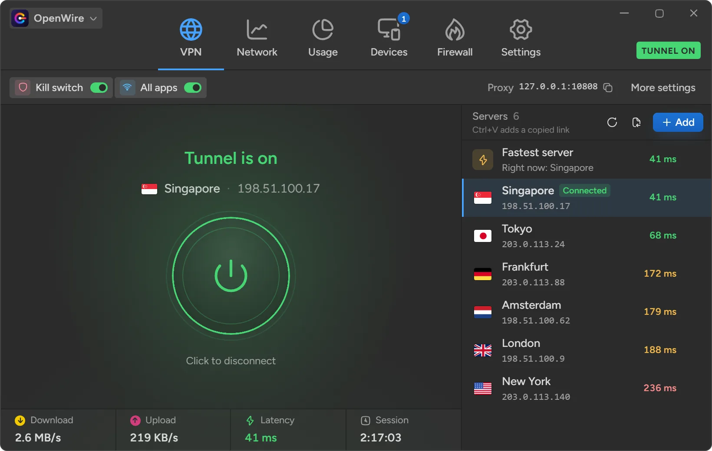
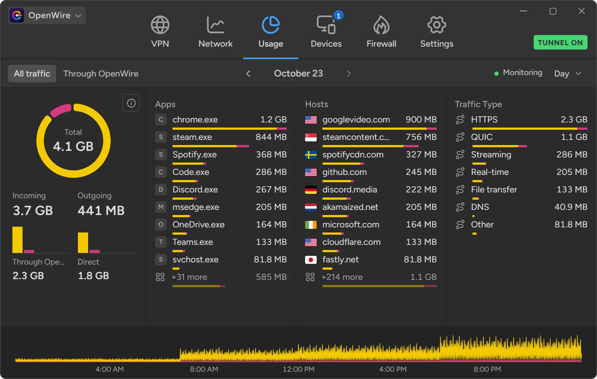
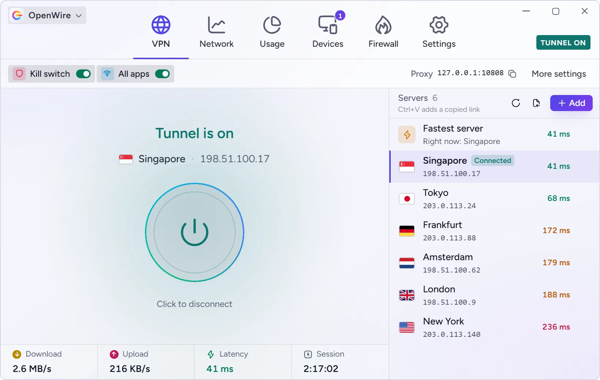
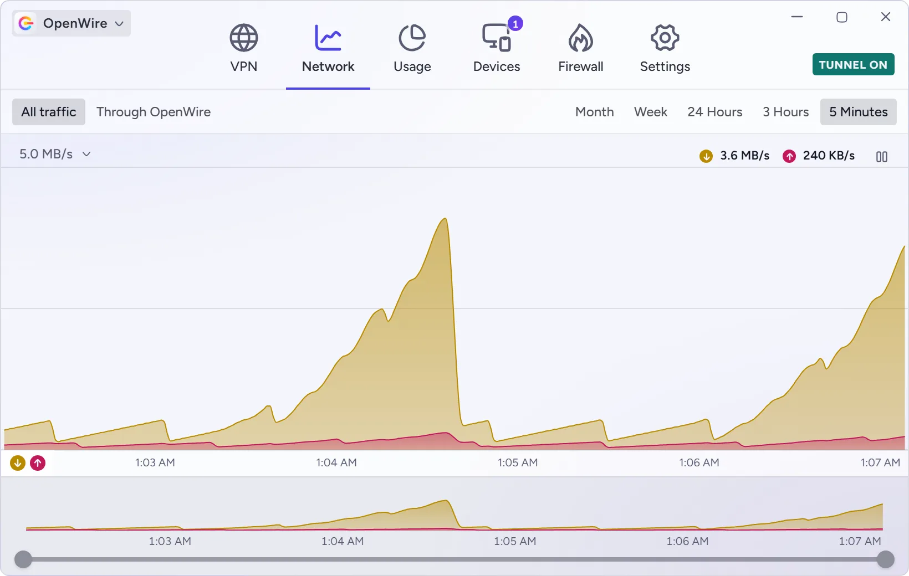
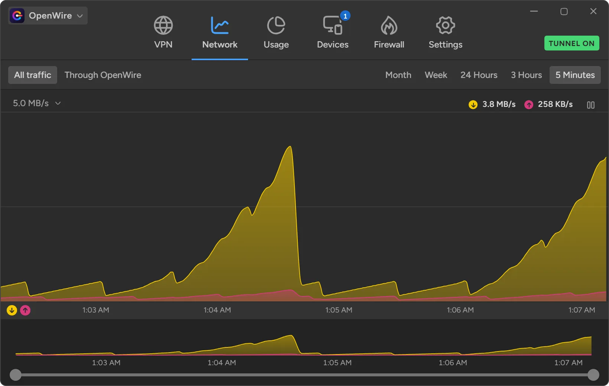
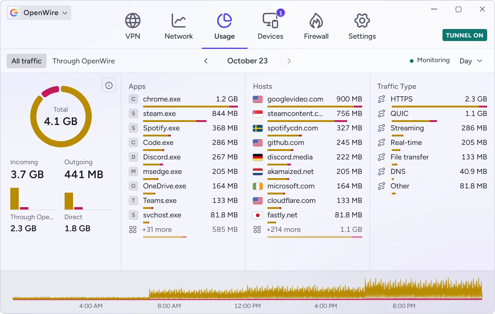
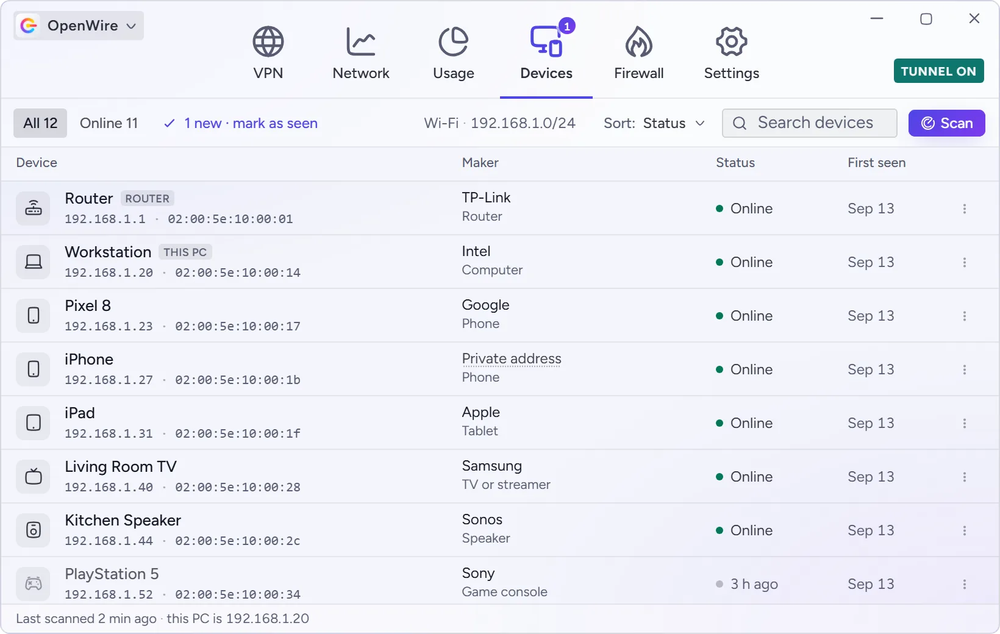
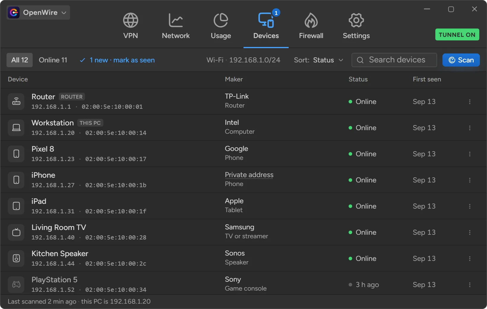
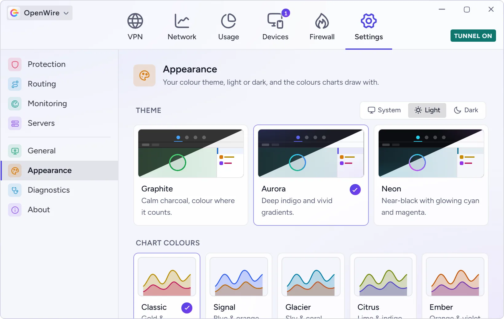
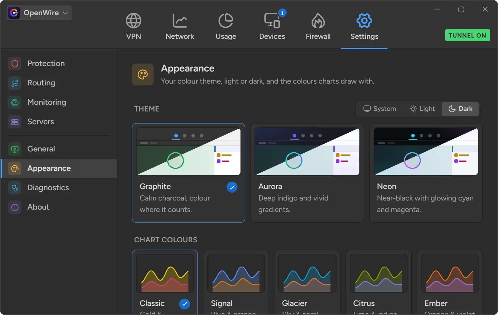

<div align="center">

<picture>
  <source media="(prefers-color-scheme: dark)" srcset="apps/desktop-app/public/logo-dark.svg">
  
</picture>

# OpenWire

**An open-source network monitor and secure tunnel for Windows.**<br>
See every app, host and device on your network, and route your traffic through your own server - all from one app.

[](LICENSE)


<table>
  <tr>
    <td></td>
    <td></td>
  </tr>
</table>

</div>

---

## Why OpenWire?

Network monitors like GlassWire show you where your traffic goes, but they are closed source and sold by subscription. VPN apps hide your traffic, but only through their own servers. OpenWire does both - openly:

- **Free and open source** under the GPL. No account, no subscription, no telemetry.
- **Your own servers.** Connect to any VLESS or Trojan server you control, with a share link.
- **Local by design.** Usage history, device lists and IP-to-country lookups all stay on your PC.
- **Light on resources.** A Rust core and a native webview - no bundled browser engine.

## Features

### Secure tunnel

| Light | Dark |
| --- | --- |
|  |  |

Route your apps through your own server over **VLESS or Trojan with TLS**, with a TLS server name (SNI) you choose. OpenWire runs a local SOCKS5/HTTP proxy and points Windows at it, so every app that respects the system proxy goes through the tunnel.

- Import servers by pasting a `vless://` or `trojan://` link, or from a screenshot of a QR code - and share them as a link or QR code
- Live latency for every server, and a **Fastest server** option picked at connect time
- **Kill switch** that blocks traffic if the server drops, instead of letting it out unprotected
- **Local network bypass**, so printers, NAS drives and other local devices stay reachable
- Your previous proxy settings are saved before anything changes and restored on disconnect, on exit, and even after a crash

### Live network graph

| Light | Dark |
| --- | --- |
|  |  |

A GlassWire-style graph of everything your PC sends and receives, updated every second. Switch between 5 minutes, 3 hours, 24 hours, a week and a month, and filter to just the traffic that went through the tunnel.

### Usage by app, host and traffic type

| Light | Dark |
| --- | --- |
|  |  |

See which apps used the most data, which hosts they talked to - with the country each one is in - and what kind of traffic it was (HTTPS, QUIC, streaming, real-time, file transfer and more). Browse any day, week or month of history.

Turn on **detailed monitoring** to cover every app on your PC, not just tunnelled traffic. It reads Windows' own network events through a small background service: no kernel driver, and never the contents of your traffic.

### Devices on your network

| Light | Dark |
| --- | --- |
|  |  |

Scan your Wi-Fi or Ethernet network to see every connected device - its name, maker, type and when it was first seen. OpenWire can keep watching in the background and tell you when a **new device joins**.

### Speed on the taskbar

Live upload and download speed sits on the Windows taskbar, just left of the clock. It hides with the taskbar, stays out of the way of full-screen apps, and opens OpenWire with a click.

### Themes

| Light | Dark |
| --- | --- |
|  |  |

Three colour themes - **Aurora**, **Graphite** and **Neon** - each in light and dark, plus five palettes for the charts. Even the app and tray icons follow your light or dark mode. The screenshots here use Aurora in light mode and Graphite in dark.

## Installation

### Download

Download the latest `OpenWire_x.y.z_x64-setup.exe` from the [**Releases**](https://github.com/Imesh-Madushan-Dev/OpenWire/releases) page and run it.

The installer asks for administrator approval once. During setup it offers to turn on detailed monitoring; you can change that later in **Settings > Monitoring**.

**Requirements:** Windows 10 or 11 (64-bit) with the Microsoft Edge WebView2 runtime, which Windows 11 already includes.

### Add your first server

1. Copy your server's `vless://` or `trojan://` share link.
2. In OpenWire, press **Ctrl+V** on the VPN page, or click **Add**.
3. Click the power button to connect.

Supported links use TLS over TCP. Links for REALITY, XTLS, WebSocket, gRPC or HTTPUpgrade transports are rejected at import with a message saying why.

## How it works

```
your apps ──SOCKS5/HTTP──▶ OpenWire (127.0.0.1:10808) ──VLESS or Trojan over TLS──▶ your server ──▶ internet
```

1. **Inbound** - one local listener speaks both SOCKS5 and HTTP proxy, bound to `127.0.0.1` only, so it can never become an open relay.
2. **Routing** - local network and loopback destinations can skip the tunnel; everything else goes through it.
3. **Outbound** - a TLS connection to your server carries the real destination inside the encrypted VLESS or Trojan stream.
4. **System proxy** - Windows is pointed at the local listener while connected, and put back exactly as it was afterwards.

For the full technical picture - certificate checking, the usage meter's data sources, and the safety guarantees - see the [developer guide](apps/desktop-app/README.md).

## Privacy

OpenWire has no accounts, no analytics and no telemetry. Beyond the servers you add, the only things it talks to are the devices on your own local network, when it scans them.

| Data | Where it stays |
| --- | --- |
| Servers, settings, usage history, device list | `%APPDATA%\com.openwire.desktop` on your PC |
| IP-to-country lookups | A database built into the app - lookups never leave your PC |
| Detailed monitoring | Read from Windows' network events by a local service; traffic contents are never read |

## Building from source

**Prerequisites:** [Bun](https://bun.sh) 1.2+, [Rust](https://rustup.rs) (stable, MSVC toolchain), and the [Tauri prerequisites for Windows](https://tauri.app/start/prerequisites/).

```bash
git clone https://github.com/Imesh-Madushan-Dev/OpenWire.git
cd OpenWire
bun install

cd apps/desktop-app
bun run tauri:dev      # run the app with hot reload
bun run tauri:build    # build the installer into src-tauri/target/release/bundle
```

### Tests

```bash
cd apps/desktop-app
bun test tests                     # frontend unit tests
cd src-tauri && cargo test         # Rust unit tests
```

### Screenshots

The screenshots in this README are generated from the real UI running on made-up data, so no real addresses or devices appear in them. To regenerate them (needs Node and Chrome or Edge):

```bash
cd apps/desktop-app
bun scripts/screenshots.ts         # writes docs/screenshots/*.webp
```

## Project structure

```
apps/desktop-app/
├── src/                  React frontend
│   ├── components/       window chrome, shared controls
│   ├── features/         vpn, servers, usage, devices, firewall, settings
│   ├── lib/              IPC, types, formatting, themes
│   └── demo/             made-up data for the README screenshots
├── src-tauri/            Rust backend
│   ├── src/commands/     the IPC surface the UI calls
│   ├── src/core/         tunnel, usage history, network monitor, LAN scan, system proxy
│   ├── src/taskbar.rs    the taskbar speed readout
│   └── windows/          installer hooks
└── scripts/              logo and screenshot generators
```

## Roadmap

- [ ] **Firewall** - allow or block apps from reaching the network
- [ ] **TUN mode** - a virtual network adapter for apps that ignore the system proxy
- [ ] More transports - REALITY, WebSocket and gRPC
- [ ] Automatic routing on macOS and Linux (the tunnel already runs there)

## Contributing

Contributions are welcome! For a bug, please [open an issue](https://github.com/Imesh-Madushan-Dev/OpenWire/issues) with your OpenWire version (from **Settings > About**) and steps to reproduce it. For a larger change, open an issue to discuss it first.

Before sending a pull request, please make sure the tests pass and the code type-checks:

```bash
cd apps/desktop-app
bunx tsc -b && bun test tests && bun run lint
cd src-tauri && cargo test && cargo clippy
```

## Contributors

| | Role |
| --- | --- |
| [**Imesh Madushan**](https://github.com/Imesh-Madushan-Dev) | Creator and maintainer |
| [**Claude**](https://www.anthropic.com/claude) by Anthropic | AI pair programmer, through [Claude Code](https://claude.com/claude-code) |

Want to see your name here? See [Contributing](#contributing).

## Acknowledgements

- IP geolocation by [DB-IP](https://db-ip.com), licensed under [CC BY 4.0](https://creativecommons.org/licenses/by/4.0/)
- MAC address vendors from the [IEEE Registration Authority](https://standards-oui.ieee.org/)
- Built with [Tauri](https://tauri.app), [React](https://react.dev), [Recharts](https://recharts.org), [Motion](https://motion.dev) and [Hugeicons](https://hugeicons.com)
- Layout inspired by [GlassWire](https://www.glasswire.com)

## Disclaimer

OpenWire is a tool for routing your own traffic through servers you control. You are responsible for using it in line with the laws of your country and the terms of the networks and services you use.

## License

OpenWire is free software, released under the [GNU General Public License v3.0](LICENSE). You may use, study, share and modify it; if you distribute a modified version, it must be released under the same licence.

Copyright © 2026 Imesh Madushan
